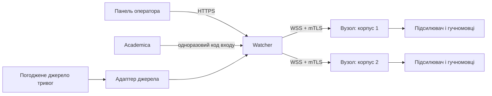
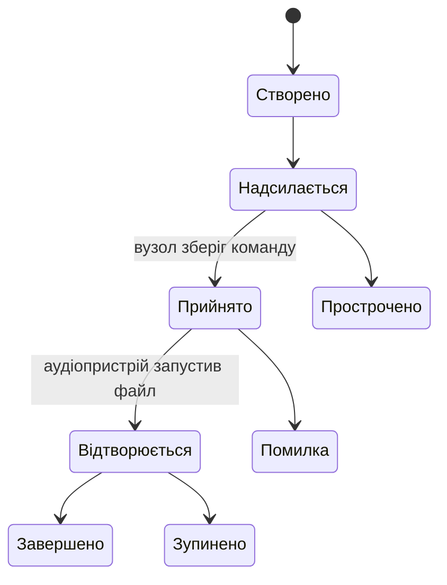

# Архітектура системи

## Призначення

KGTA Alert передає погоджені команди оповіщення до обладнання закладу, підтверджує їх обробку та зберігає журнал подій. Система допомагає виконувати затверджені процедури закладу й не замінює офіційні канали цивільного захисту.



## Компоненти

### Watcher

Окремий вебзастосунок на піддомені закладу. Перевіряє права користувачів, створює команди, надсилає їх вузлам, приймає підтвердження, зберігає конфігурацію та аудит. Команда посилається лише на опублікований аудіосценарій. Сервер не передає довільні файли або команди операційної системи.

### Панель оператора

Адаптивний вебінтерфейс/PWA для швидкого запуску дозволених сценаріїв. Доступ до дій визначає сервер, а не видимість кнопок. PWA кешує оболонку інтерфейсу, але не вважається автономним каналом запуску: без мережі до Watcher керування з телефону недоступне.

### Вузол оповіщення (Edge Agent)

Windows-служба на комп’ютері, фізично підключеному до аудіообладнання. Працює незалежно від графічного інтерфейсу й входу користувача у Windows. Зберігає погоджені аудіофайли, останню перевірену конфігурацію, локальну чергу подій і перелік уже оброблених команд.

### База даних

PostgreSQL — основне сховище Watcher. SQLite на вузлі використовується лише для локального стану, дедуплікації команд і черги надсилання подій.

## Межі модулів

```text
src/
  Watcher.Api/              HTTP API, SignalR, автентифікація
  Watcher.Application/      сценарії використання та політики
  Watcher.Domain/            сутності й бізнес-правила
  Watcher.Infrastructure/   PostgreSQL та зовнішні інтеграції
  Watcher.Contracts/        версійовані DTO та події
  Edge.Agent/                Windows-служба
  Edge.Gui/                  локальний інтерфейс, якщо він буде потрібен
tests/
  Watcher.UnitTests/
  Watcher.IntegrationTests/
  Edge.Agent.Tests/
```

Створювати проєкти й шари слід разом із першою реалізацією відповідної відповідальності. Залежності домену не повинні посилатися на вебінфраструктуру чи базу даних.

## Життєвий цикл команди

Кожна команда має незмінний UUID `command_id` і окремий стан доставки для кожної цільової локації.



`Прийнято` підтверджує отримання й збереження команди. `Відтворюється` підтверджує початок аудіо. Панель має показувати ці стани окремо. Повторне надсилання того самого `command_id` не запускає сигнал удруге.

## Чернеткова матриця пріоритетів

| Рівень | Тип | Початкова поведінка |
| --- | --- | --- |
| 1 | Екстрене оповіщення | зупиняє звуки нижчих рівнів |
| 2 | Оперативне оголошення | перериває розклад і фонове аудіо |
| 3 | Дзвінок за розкладом | перериває фонове аудіо |
| 4 | Фонове аудіо | не перериває інші сценарії |

Цю таблицю треба погодити з відповідальними за безпеку закладу до реалізації. Команда «Відбій» має бути окремою дією з посиланням на активну подію; вона не повинна непомітно вимикати будь-яке аудіо.

## Поведінка під час відмов

- Якщо Watcher недоступний, вузол завершує вже прийняту команду за локальною політикою та зберігає події у черзі.
- Якщо мережі немає, панель показує вузол як недоступний; оператор не бачить непідтверджену доставку як успішну.
- Якщо аудіопристрій відсутній або файл не пройшов перевірку, вузол повідомляє про помилку й не підміняє файл іншим.
- Якщо база Watcher недоступна, нові команди не приймаються без запису аудиту.
- Автоматичне спрацювання від зовнішнього джерела визначається окремою погодженою політикою.

## Щоденна хвилина мовчання

Watcher планує хвилину мовчання на 09:00 за часовим поясом `Europe/Kyiv`; зміна літнього часу не змінює місцевий час запуску. Фоновий процес спить до наступного запуску, а не опитує базу протягом дня. Обробка допускається лише в межах хвилини з 09:00 до 09:00:59. Якщо процес запускається після цього вікна, він атомарно записує `missed_window` і системну подію аудиту для поточної місцевої дати. При недоступній базі цей запис повторюється не частіше ніж раз на п’ять хвилин. Команда за пропущену дату не створюється.

Фоновий процес додається через `AddMinuteOfSilenceScheduler` у реєстрації сервісів API.

Для кожної місцевої календарної дати PostgreSQL зберігає один запис розкладу з унікальною датою. Він атомарно фіксує результат і, якщо умови виконані, команду, цілі, outbox та аудит. Щоб створити команду, у базі має бути опублікований сценарій із кодом `minute_of_silence`, SHA-256 manifest hash із 64 шістнадцяткових символів і принаймні один активний корпус. Якщо сценарій не опублікований, hash некоректний або активних корпусів немає, система записує результат `skipped` із причиною та системною подією аудиту; команду й outbox не створює. Перевірка hash підтверджує лише формат ідентифікатора, але не наявність аудіофайлу на вузлах.

Строк дії запланованої команди — рівно 09:01 за `Europe/Kyiv` у день запуску, збережений як UTC instant. Операторська команда має строк дії п’ять хвилин від створення. `Queued` означає лише запис команди й outbox; це не підтвердження відтворення. Фактичне відтворення підтверджує тільки відповідна подія вузла, наприклад `Playing` або `Completed`. Майбутній споживач outbox і вузол перед запуском мають відхиляти команду, якщо `now >= expiresAtUtc`, та перевіряти доступність і hash аудіоманіфесту. Наразі такого споживача та вузлового шляху немає.

Системна команда не має користувача-ініціатора. Її можна переглядати лише користувачам із глобальною роллю адміністратора або аудитора.

## Матеріалізація доставок на пристрої

Outbox-подія `alert_command.created` може бути матеріалізована в окремі записи `CommandDelivery` для кожного незаблокованого пристрою активного корпусу, на який націлена команда. Кожен запис зберігає стан (`Pending`, `InFlight`, `Accepted`, `Playing`, `Completed`, `Stopped`, `Rejected`, `Failed` або `Expired`), кількість і час спроб, наступну спробу та строк дії команди. Якщо строк уже минув, доставка одразу створюється зі станом `Expired` без наступної спроби.

Матеріалізатор блокує рядок outbox у PostgreSQL і в одній транзакції створює доставки, запис аудиту та позначає подію як матеріалізовану. Унікальний індекс `(CommandId, DeviceId)` додатково захищає від дублювання. `OutboxMessage.ProcessedAtUtc` означає, що список доставок створено; це не підтвердження мережевого надсилання чи відтворення. Підтвердження `Playing` і `Completed` має надходити від автентифікованого вузла.

Цей шар поки не надсилає мережевих повідомлень і не запускається фоновим воркером. Автоматичну доставку не можна вмикати, доки transport безпосередньо перед надсиланням повторно не перевіряє строк дії й відкликання пристрою, не перевіряє підписаний контракт, а призначення не має стійкого порядкового номера в межах корпусу. mTLS, sequence allocation і Windows-вузол реалізуються окремо відповідно до ADR 0008.
