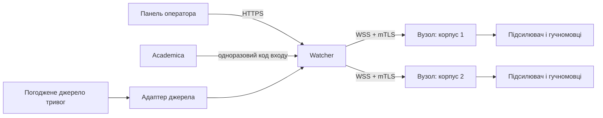
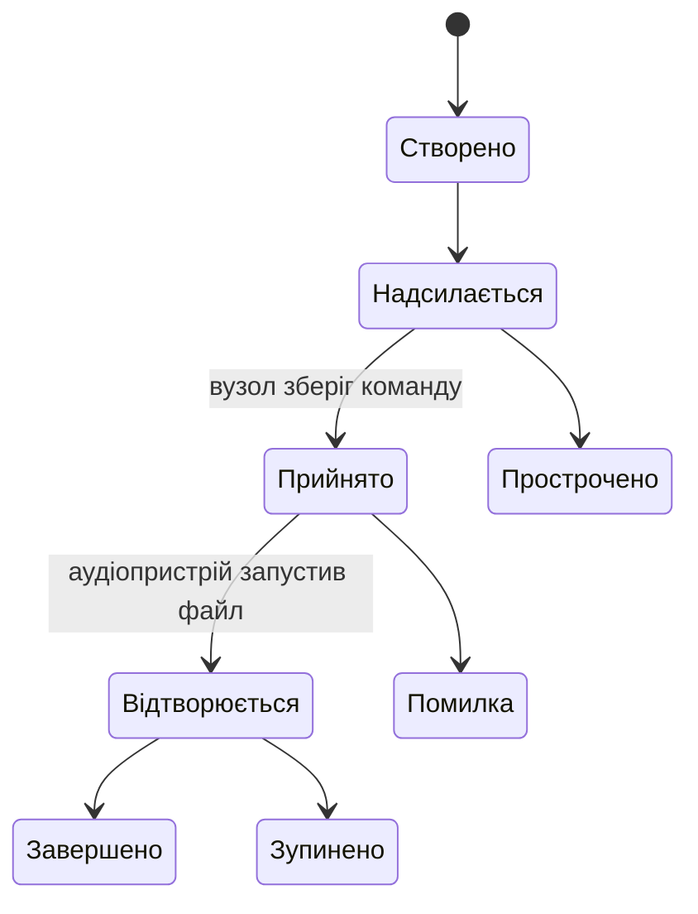

# Архітектура системи

## Призначення

KGTA Alert передає погоджені команди оповіщення до обладнання закладу, підтверджує їх обробку та зберігає журнал подій. Система допомагає виконувати затверджені процедури закладу й не замінює офіційні канали цивільного захисту.



## Компоненти

### Watcher

Окремий вебзастосунок на піддомені закладу. Перевіряє права користувачів, створює команди, надсилає їх вузлам, приймає підтвердження, зберігає конфігурацію та аудит. Команда посилається лише на опублікований аудіосценарій. Сервер не передає довільні файли або команди операційної системи.

### Панель оператора

Адаптивний вебінтерфейс/PWA для швидкого запуску дозволених сценаріїв. Доступ до дій визначає сервер, а не видимість кнопок. PWA кешує оболонку інтерфейсу, але не вважається автономним каналом запуску: без мережі до Watcher керування з телефону недоступне.

### Вузол оповіщення (Edge Agent)

Windows-служба на комп’ютері, фізично підключеному до аудіообладнання. Працює незалежно від графічного інтерфейсу й входу користувача у Windows. Зберігає погоджені аудіофайли, останню перевірену конфігурацію, локальну чергу подій і перелік уже оброблених команд.

### База даних

PostgreSQL — основне сховище Watcher. SQLite на вузлі використовується лише для локального стану, дедуплікації команд і черги надсилання подій.

## Межі модулів

```text
src/
  Watcher.Api/              HTTP API, SignalR, автентифікація
  Watcher.Application/      сценарії використання та політики
  Watcher.Domain/            сутності й бізнес-правила
  Watcher.Infrastructure/   PostgreSQL та зовнішні інтеграції
  Watcher.Contracts/        версійовані DTO та події
  Edge.Agent/                Windows-служба
  Edge.Gui/                  локальний інтерфейс, якщо він буде потрібен
tests/
  Watcher.UnitTests/
  Watcher.IntegrationTests/
  Edge.Agent.Tests/
```

Створювати проєкти й шари слід разом із першою реалізацією відповідної відповідальності. Залежності домену не повинні посилатися на вебінфраструктуру чи базу даних.

## Життєвий цикл команди

Кожна команда має незмінний UUID `command_id` і окремий стан доставки для кожної цільової локації.



`Прийнято` підтверджує отримання й збереження команди. `Відтворюється` підтверджує початок аудіо. Панель має показувати ці стани окремо. Повторне надсилання того самого `command_id` не запускає сигнал удруге.

## Чернеткова матриця пріоритетів

| Рівень | Тип | Початкова поведінка |
| --- | --- | --- |
| 1 | Екстрене оповіщення | зупиняє звуки нижчих рівнів |
| 2 | Оперативне оголошення | перериває розклад і фонове аудіо |
| 3 | Дзвінок за розкладом | перериває фонове аудіо |
| 4 | Фонове аудіо | не перериває інші сценарії |

Цю таблицю треба погодити з відповідальними за безпеку закладу до реалізації. Команда «Відбій» має бути окремою дією з посиланням на активну подію; вона не повинна непомітно вимикати будь-яке аудіо.

## Поведінка під час відмов

- Якщо Watcher недоступний, вузол завершує вже прийняту команду за локальною політикою та зберігає події у черзі.
- Якщо мережі немає, панель показує вузол як недоступний; оператор не бачить непідтверджену доставку як успішну.
- Якщо аудіопристрій відсутній або файл не пройшов перевірку, вузол повідомляє про помилку й не підміняє файл іншим.
- Якщо база Watcher недоступна, нові команди не приймаються без запису аудиту.
- Автоматичне спрацювання від зовнішнього джерела визначається окремою погодженою політикою.
