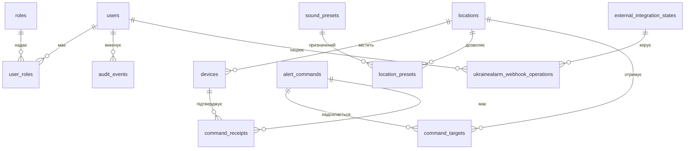

# Структура бази даних

## Загальні правила

- PostgreSQL є авторитетним сховищем Watcher. SQLite вузла містить лише локальні дані, необхідні для роботи під час втрати зв’язку.
- Дати й час зберігаються як `timestamptz` у UTC.
- Ідентифікатори сутностей — UUID. Публічний код локації та код сценарію мають окремі унікальні обмеження.
- Секрети не зберігаються відкритим текстом. Аудитові записи не змінюються звичайними операціями застосунку.
- Зміни схеми виконуються міграціями EF Core. Ручні зміни production-бази не допускаються.

## Сутності та зв’язки

| Таблиця                      | Основні поля                                                                                  | Призначення                                                   |
| ---------------------------- | --------------------------------------------------------------------------------------------- | ------------------------------------------------------------- |
| `users`                      | `id`, `external_subject`, `email`, `is_active`                                                | Облікові записи з довіреного постачальника входу              |
| `roles`                      | `id`, `code`                                                                                  | Ролі `admin`, `sound_engineer`, `notificator`, `auditor`      |
| `user_roles`                 | `user_id`, `role_id`, `location_id?`                                                          | Глобальні права або права в конкретній локації                |
| `locations`                  | `id`, `code`, `name`, `is_active`                                                             | Корпус або окрема зона трансляції                             |
| `devices`                    | `id`, `location_id`, `certificate_thumbprint`, `status`                                       | Зареєстровані вузли та стан сертифіката                       |
| `sound_presets`              | `id`, `code`, `priority`, `manifest_hash`, `status`                                           | Погоджені сценарії відтворення                                |
| `location_presets`           | `location_id`, `preset_id`, `is_enabled`                                                      | Сценарії, дозволені для локації                               |
| `alert_commands`             | `id`, `kind`, `preset_id`, `initiated_by_user_id`, `created_at`                               | Створені команди та ініціатор                                 |
| `command_targets`            | `command_id`, `location_id`, `sequence`, `state`                                              | Намір і порядковий номер команди в кожній локації             |
| `location_command_sequences` | `location_id`, `next_sequence`                                                                | Транзакційний лічильник наступного номера команди для локації |
| `command_receipts`           | `id`, `command_id`, `device_id`, `status`, `occurred_at`                                      | Підтвердження отримання, запуску та завершення                |
| `audit_events`               | `id`, `event_type`, `actor_type`, `actor_id`, `payload`, `occurred_at`                        | Історія дій користувачів і системи                            |
| `outbox_messages`            | `id`, `command_id`, `event_type`, `payload`, `created_at_utc`, `processed_at_utc`, `attempts` | Надійна черга подій для подальшої доставки                    |
| `device_sessions`            | `id`, `device_id`, `connected_at`, `disconnected_at`, `last_seen_at`                          | Історія технічних з’єднань і спільна присутність вузлів        |
| `ukrainealarm_webhook_operations` | `id`, `idempotency_key`, `actor_user_id`, `action`, `state`, `callback_url`, `outcome_code`, timestamps | Довговічний стан ручних змін callback UkraineAlarm; активна або невизначена операція блокує наступну |
| `external_integration_states` | `integration_code`, `is_registered?`, `updated_at_utc`                                      | Останній підтверджений стан реєстрації webhook; `NULL` означає невідомий стан |
| `automatic_alert_dispatch_states` | `id`, `has_open_episode`, `scope`, `scope_id`, `start_command_id`, `started_at_utc`, `last_decision_code`, `updated_at_utc` | Єдиний серіалізований стан епізоду автоматичної тривоги для Кременчука |

Для `ukrainealarm_webhook_operations` унікальний індекс гарантує одну активну операцію зі станом `Pending`, `Running` або `Unknown`; окремий унікальний індекс захищає `Idempotency-Key`. Таблиця стану містить один рядок `ukrainealarm_webhook`, який блокується `FOR UPDATE` під час запуску, завершення й ручної звірки. Намір і аудит фіксуються перед зовнішнім HTTP-запитом. `Unknown` не очищається автоматично: адміністратор звіряє стан у кабінеті UkraineAlarm і додає окремий аудований перехід. Відкат міграції заборонений, якщо збереглася історія операцій або стан інтеграції.

Рядок `automatic_alert_dispatch_states` із ключем `kremenchuk` створюється міграцією. Він блокується `FOR UPDATE` перед оцінкою спостережень. Перехід епізоду та команда старту чи відбою зберігаються атомарно разом із цілями, послідовностями, outbox і аудитом. Таблиця містить лише поточний епізод; історію команд і рішень зберігають `alert_commands` та `audit_events`.

Фізичну схему підтримують EF Core migrations. Кожне повідомлення outbox посилається на одну команду; унікальний індекс не дозволяє створити для неї дубльовану подію. Непроцесовані записи читаються за індексом стану й часу створення.

Outbox фіксує намір доставки в тій самій транзакції, що команду, цілі та аудит. API повертає `202 Accepted` після успішного commit. Worker матеріалізує непроцесовані події `alert_command.created` у записи `command_deliveries`. Для START він створює доставку кожному активному вузлу цільового корпусу. Для STOP API в тій самій транзакції фіксує доставку кожному вузлу вихідного START у вибраних корпусах, включно з ще не відправленими командами; вищий `sequence` STOP блокує запізнілий START. Outbox не додає до STOP нові пристрої. Окремий transport worker надсилає ці доставки активним mTLS-підключенням пристрою через WebSocket. Доставки захоплюються через `FOR UPDATE SKIP LOCKED`; мережевий виклик відбувається після commit, а тайм-аут квитанції планує повтор із тим самим `command_id`. Параметри `DeviceCommandTransport:Enabled`, `PollInterval`, `AcknowledgementTimeout`, `InitialRetryDelay`, `MaximumRetryDelay` і `BatchSize` керують роботою. За замовчуванням transport увімкнений, опитує кожні 250 мс, очікує квитанцію 10 секунд, повторює з backoff від 1 до 15 секунд і бере до 50 записів за цикл. Сесії WebSocket локальні для процесу; репліки обробляють лише пристрої, підключені до відповідної репліки.

Worker використовує нову DI scope для кожного циклу та обробляє події послідовно. Матеріалізатор блокує рядок outbox у PostgreSQL, тому кілька реплік можуть безпечно побачити ту саму подію: одна створює доставки, інші отримують `AlreadyProcessed`. Після помилки обробка поточного пакета зупиняється; подія залишається непроцесованою і буде повторно прочитана в наступному циклі. Лічильник `attempts` не змінюється. Повідомлення самого worker-а містять лише тип помилки та ID outbox-запису: вони не містять текст винятку, payload чи секретів. Події інших типів worker не вибирає.

`OutboxMessage.ProcessedAtUtc` означає лише, що набір доставок підготовлений. `202 Accepted` не підтверджує отримання чи виконання команди; фактичний результат фіксує квитанція пристрою.

Поточні події автентифікації — `auth.login.succeeded`, `auth.login.rejected` і `auth.logout`. Успішна дія містить ID локального користувача; відхилена — лише узагальнену причину. Записи містять спосіб входу та час UTC; email, зовнішній subject, Google-токени, IP-адреси й cookie до payload не додаються.

## Обмеження та індекси

- Унікальні значення: `locations.code`, `roles.code`, `sound_presets.code`, `users.external_subject`.
- Пара `(command_id, location_id)` у `command_targets` унікальна.
- Пара `(location_id, sequence)` у `command_targets` унікальна; номер завжди додатний.
- Лічильник локації змінюється атомарно в тій самій транзакції, що команда, ціль, outbox та аудит.
- Міграція послідовностей є forward-only: downgrade видалив би підтверджений порядок команд. Попередня версія застосунку може залишити схему без змін: тригер БД присвоїть номер цілям, вставленим без поля `sequence`.
- Міграцію області ролей можна відкотити лише за відсутності глобальних призначень (`user_roles.location_id IS NULL`): попередня схема вимагає локацію для кожної ролі. Якщо глобальні ролі є, мігратор зупиниться до зміни схеми; збережіть поточну версію або спершу підготуйте сумісне перенесення даних окремою міграцією. Не видаляйте призначення ролей для обходу перевірки.
- Індекс за часом у `audit_events` та `alert_commands` потрібен для перегляду історії.
- Індекс `(device_id, last_seen_at)` допомагає показувати останній зв’язок вузла.
- Відкликання доступу фіксується полем стану або `revoked_at`; історичні команди й аудит не видаляються штатним інтерфейсом.

## Локальна база вузла

| Таблиця                  | Вміст                                                         |
| ------------------------ | ------------------------------------------------------------- |
| `processed_commands`     | Ідентифікатори команд і збережений результат дедуплікації     |
| `outbox_events`          | Непідтверджені події для надсилання після відновлення зв’язку |
| `configuration_snapshot` | Остання перевірена версія локальних налаштувань               |
| `asset_manifest`         | Дозволені аудіофайли та їхні SHA-256 відбитки                 |

Аудіофайли зберігаються окремо. Вузол перевіряє їхній відбиток перед публікацією або відтворенням.
