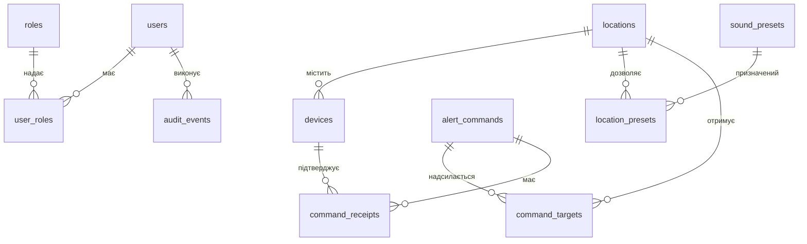

# Структура бази даних

## Загальні правила

- PostgreSQL є авторитетним сховищем Watcher. SQLite вузла містить лише локальні дані, необхідні для роботи під час втрати зв’язку.
- Дати й час зберігаються як `timestamptz` у UTC.
- Ідентифікатори сутностей — UUID. Публічний код локації та код сценарію мають окремі унікальні обмеження.
- Секрети не зберігаються відкритим текстом. Аудитові записи не змінюються звичайними операціями застосунку.
- Зміни схеми виконуються міграціями EF Core. Ручні зміни production-бази не допускаються.

## Сутності та зв’язки

| Таблиця | Основні поля | Призначення |
| --- | --- | --- |
| `users` | `id`, `external_subject`, `email`, `is_active` | Облікові записи з довіреного постачальника входу |
| `roles` | `id`, `code` | Ролі `admin`, `sound_engineer`, `notificator`, `auditor` |
| `user_roles` | `user_id`, `role_id`, `location_id?` | Глобальні права або права в конкретній локації |
| `locations` | `id`, `code`, `name`, `is_active` | Корпус або окрема зона трансляції |
| `devices` | `id`, `location_id`, `certificate_thumbprint`, `status` | Зареєстровані вузли та стан сертифіката |
| `sound_presets` | `id`, `code`, `priority`, `manifest_hash`, `status` | Погоджені сценарії відтворення |
| `location_presets` | `location_id`, `preset_id`, `is_enabled` | Сценарії, дозволені для локації |
| `alert_commands` | `id`, `kind`, `preset_id`, `initiated_by_user_id`, `created_at` | Створені команди та ініціатор |
| `command_targets` | `command_id`, `location_id`, `state` | Стан доставки команди в кожну локацію |
| `command_receipts` | `id`, `command_id`, `device_id`, `status`, `occurred_at` | Підтвердження отримання, запуску та завершення |
| `audit_events` | `id`, `event_type`, `actor_type`, `actor_id`, `payload`, `occurred_at` | Історія дій користувачів і системи |
| `outbox_messages` | `id`, `command_id`, `event_type`, `payload`, `created_at_utc`, `processed_at_utc`, `attempts` | Надійна черга подій для подальшої доставки |
| `device_sessions` | `id`, `device_id`, `connected_at`, `last_seen_at` | Історія технічних з’єднань |

Фізичну схему підтримують EF Core migrations. Кожне повідомлення outbox посилається на одну команду; унікальний індекс не дозволяє створити для неї дубльовану подію. Непроцесовані записи читаються за індексом стану й часу створення.

Outbox фіксує намір доставки в тій самій транзакції, що команду, цілі та аудит. API повертає `202 Accepted` після успішного commit. До появи взаємної TLS-аутентифікації вузлів фоновий доставник не запускається: події залишаються в очікуванні.

## Обмеження та індекси

- Унікальні значення: `locations.code`, `roles.code`, `sound_presets.code`, `users.external_subject`.
- Пара `(command_id, location_id)` у `command_targets` унікальна.
- Індекс за часом у `audit_events` та `alert_commands` потрібен для перегляду історії.
- Індекс `(device_id, last_seen_at)` допомагає показувати останній зв’язок вузла.
- Відкликання доступу фіксується полем стану або `revoked_at`; історичні команди й аудит не видаляються штатним інтерфейсом.

## Локальна база вузла

| Таблиця | Вміст |
| --- | --- |
| `processed_commands` | Ідентифікатори команд і збережений результат дедуплікації |
| `outbox_events` | Непідтверджені події для надсилання після відновлення зв’язку |
| `configuration_snapshot` | Остання перевірена версія локальних налаштувань |
| `asset_manifest` | Дозволені аудіофайли та їхні SHA-256 відбитки |

Аудіофайли зберігаються окремо. Вузол перевіряє їхній відбиток перед публікацією або відтворенням.
